# AI usage

This project was built with Claude Code (Anthropic) working in a terminal, directed by one human, Abhishek Tiwari. This file says what the AI did, what the human did, where the AI was wrong, and how that was caught. Every number here is in a file you can open.

## 1. Summary

- **What the AI did:** research (docs repo, node source, public project pages, web search through Exa), the design and threat model, all Solidity, all TypeScript and Python scripts, every test, the live testnet experiments, and the documentation.
- **What the human did:** chose the target (the Q-Day Drill) and the constraints, supplied and funded the testnet accounts, made every go/no-go call, did the steps that need a person (faucet sign-ins, messages to organisers, the registration step), and approved anything outward-facing (GitHub, public posts). No Solidity in this repository was written by hand.
- **How trust was earned:** nothing the AI wrote was accepted until a test, a live transaction or a source document confirmed it. A separate agent that saw only the contract sources tried to break the vault.
- **Where the AI was wrong:** 14 logged cases in [`docs/ai-corrections.md`](docs/ai-corrections.md), including a misread deadline, a wrong signer, two tests that passed for the wrong reason, and evidence that would have overstated a result.

## 2. Workflow

```mermaid
flowchart LR
  R[Research<br/>docs, node source, project pages] --> T[Threat model<br/>attack tree, invariants]
  T --> S[Spikes<br/>live testnet experiments]
  S --> B[Build<br/>contracts and scripts]
  B --> V1[Verify 1<br/>unit and adversarial tests]
  V1 --> V2[Verify 2<br/>invariants and Medusa]
  V2 --> V3[Verify 3<br/>Halmos, Slither, Semgrep, mutation]
  V3 --> RT[Blind AI red team]
  RT --> L[Live attack sweeps]
  L --> H[Human gates<br/>fund, register, publish]
```

Each sub-phase followed a fixed loop (plan, verify the ground, build, test, attack it, security pass, record, commit). The prompt that drove it is [`docs/11-BUILD-PROMPT.md`](docs/11-BUILD-PROMPT.md); the working rules are in [`docs/07-AI-WORKFLOW.md`](docs/07-AI-WORKFLOW.md).

## 3. Tools

| Tool | Used for |
|---|---|
| Claude Code (Opus for design and review, Sonnet for implementation) | Planning, code, tests, documentation |
| Exa (a small local skill) | Web research that returns page text |
| Foundry | Unit, adversarial, fuzz and invariant tests, coverage |
| Medusa | A second fuzzing engine on the same properties |
| Halmos | Symbolic checks of the daily cap, the cold lock and the freeze |
| Slither, Semgrep, `forge lint` | Static analysis (Aderyn could not be installed; see corrections #9) |
| A mutation script written for this project | Deliberately breaks the contracts 27 ways and requires the tests to notice |
| `@qorechain/sdk`, `@qorechain/pqc`, viem, `@noble/post-quantum` | Real ML-DSA-87 keys and signatures in the live runs |

## 4. Provenance of the files

| Files | Author |
|---|---|
| `src/`, `test/`, `scripts/` | Written by Claude, to the human's requirements; reviewed through tests, fuzzers, analysis and the red team, not by hand-editing |
| `docs/` | Written by Claude from research and live results; the human reviewed and redirected |
| `evidence/` | Produced by the scripts; unedited |
| `README.md` and the SVGs | Generated by [`scripts/make-readme.py`](scripts/make-readme.py) from the evidence files |
| Goals, constraints, funding, approvals | Human |

## 5. Decisions that mattered

| Decision | Evidence |
|---|---|
| The drill account holds nothing and never opens a window (D-02, D-03, D-14) | Spikes S1 and S2 in [`evidence/`](evidence): a never-funded account registered and transacted through a scoped fee grant; classical-only attacks were refused before any fee |
| The vault ignores the caller (D-05) | Live replay and relay tests in [`evidence/attack-vault.json`](evidence/attack-vault.json) |
| Value split between a cold and a hot vault (D-13) | Cold-vault canary, [`evidence/phase4b-cold-canary.json`](evidence/phase4b-cold-canary.json) |
| Native proof of life (D-08) | Spike S3 |
| Attacks generated from the chain's message registry, not a hand list (D-12) | [`scripts/phase5-native.mjs`](scripts/phase5-native.mjs) |

The full log is [`docs/08-DECISIONS.md`](docs/08-DECISIONS.md).

## 6. Where the AI was wrong

All entries, with the check that caught each, are in [`docs/ai-corrections.md`](docs/ai-corrections.md). Examples:
- A deadline was first computed as about 17 hours away; converting the cut-off to IST explicitly gave about 28.
- A signer helper derived a different address from the same key; the chain reported that the account did not exist.
- A cold-vault release time was off by six days; a round-trip date conversion caught it.
- A test of "signature with a context string" passed because the SDK ignores the argument; retesting with another library showed the precompile rejects such signatures.
- Two tests passed or failed for the wrong reason because the optimiser caches `block.timestamp` across `vm.warp` and a helper call consumed `vm.expectRevert`.
- A Foundry invariant failed after the test handler became stricter; the cause was the handler's accounting, not the vault.
- The first mutation run found a surviving mutant (the reentrancy guard); guard-independent tests were added.
- The first EVM sweep from the empty drill account was refused for zero balance, which would have hidden the window check; a funded stand-in was added and both layers are reported separately.

## 7. Verification results

Test counts, invariant runs, symbolic checks, the red-team result, the live attack log and the bytecode check are summarised, with links, in the [README](README.md#how-it-was-verified).

## 8. Human contribution

The human set the goal and the "never" list (no mainnet, no keys outside `.secrets/`, nothing on the drill account), funded the testnet accounts, claimed faucet tokens, sent the questions to the organisers, and decided each phase gate. Every on-chain action that needed a person is marked in [`docs/build-log.md`](docs/build-log.md).

## 9. Reproduce

The commands are in the README. The live scripts need local testnet keys that are never committed.
