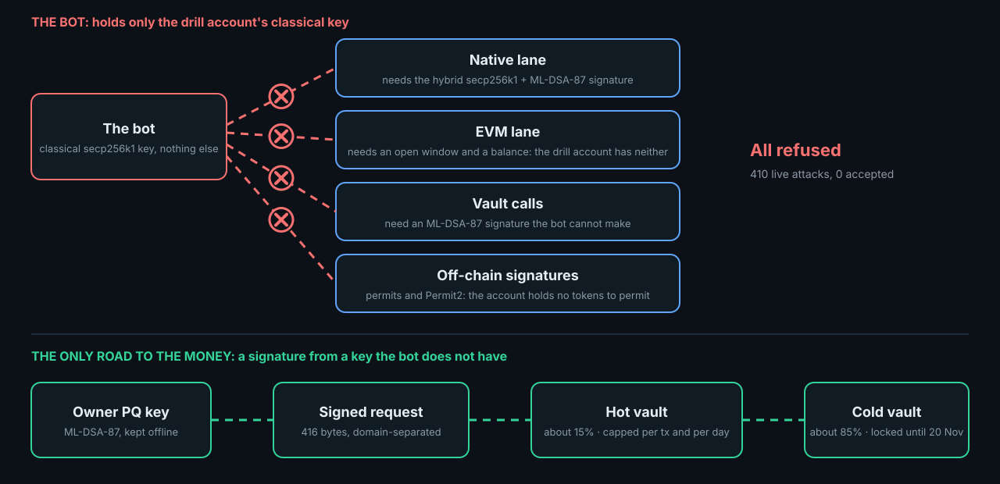

<div align="center">



<br>

**A vault on QoreChain where the money moves only with a post-quantum signature.**
**The account the attacker holds the key to is empty, has no EVM window, and never did.**

<br>

     

<br>

[**Project page**](https://build.qorechain.io/p/kavach-vault) &nbsp;·&nbsp;
[**Threat model**](docs/04-THREAT-MODEL.md) &nbsp;·&nbsp;
[**Security proofs**](SECURITY-PROOFS.md) &nbsp;·&nbsp;
[**Attack log**](evidence/attack-log.json) &nbsp;·&nbsp;
[**AI usage**](AI_USAGE.md) &nbsp;·&nbsp;
[**Vault spec**](docs/10-VAULT-SPEC.md) &nbsp;·&nbsp;
[](https://build.qorechain.io/p/kavach-vault)

<sub>QoreChain "Build Before Q-Day" · Post-Quantum AI Agents · Q-Day Survivor drill · Team Paradigm: Abhishek Tiwari</sub>

</div>

<br>

> **The question the drill asks:** if a bot holds the classical key of your account for 24 hours, what can it do?
> **Our answer:** nothing, on purpose. A classical key can act in two places: the native lane, which the chain closes to it, and an EVM window, which we never open. It can spend only what the account holds, which is zero. The money sits in two vaults that ignore who calls them and move only for an ML-DSA-87 signature the bot does not have.

<br>

## Judging criteria, and where to check each one

The drill ranks entries by this rule: **proof of life, then fewest successful attacks, then most value kept, with the jury breaking ties on the threat model.** Each row says what we claim and where to verify it.

| Criterion | Our claim | Check it here |
|---|---|---|
| **1. Proof of life** | A native, hybrid-signed transaction from the drill account in the first minutes of the drill, through a fee grant, so the account never needs a balance. Rehearsed live from the drill account | [`evidence/rehearsal-heartbeat.json`](evidence/rehearsal-heartbeat.json), [`evidence/spike-s3.json`](evidence/spike-s3.json), runbook [`docs/06-DRILL-RUNBOOK.md`](docs/06-DRILL-RUNBOOK.md) |
| **2. Fewest successful attacks** | **0 accepted** of 410 attacks in our own live simulation: 298 native, 34 EVM, 78 vault calls, plus 4 live reverted transactions | [`evidence/attack-log.json`](evidence/attack-log.json), the three sweeps in [`scripts/`](scripts) |
| **3. Most value kept** | Nothing in the account. About 85% of the value in a cold vault that cannot move before 20 Nov 00:00 UTC; the rest in a capped hot vault | [`evidence/phase4.json`](evidence/phase4.json), balances in the table below |
| **4. Threat model (tie-break)** | 26 hand-written attacks plus a sweep generated from the chain's full message registry; one written proof per invariant, each linked to tests | [`docs/04-THREAT-MODEL.md`](docs/04-THREAT-MODEL.md), [`SECURITY-PROOFS.md`](SECURITY-PROOFS.md) |
| **Category: Post-Quantum AI Agents** | Spending and access limits enforced on chain (per-transaction and rolling daily caps, recipient allowlist, timelock queue, signature deadlines, guardian freeze); authenticated messaging (a 416-byte, domain-separated signed request). The funder uses short EVM windows, capped by block count, transaction count and value, only to deploy and fund; each is closed and proven closed (`found:false`). The drill account never opens one | [`docs/10-VAULT-SPEC.md`](docs/10-VAULT-SPEC.md), [`evidence/phase4.json`](evidence/phase4.json) |
| **Best AI-native build** | Every decision, AI mistake and fix is logged | [`AI_USAGE.md`](AI_USAGE.md), [`docs/ai-corrections.md`](docs/ai-corrections.md) |
| **Submission checks** | Public repository, MIT licence, this README, testnet addresses below. Video: added before the 2 Dec deadline | [`LICENSE`](LICENSE) |

<br>

## Live on qorechain-diana (testnet)

| What | Address |
|---|---|
| Drill account (the bot gets its classical key) | `qor1hk8vnarknzqjd3aa8hcsumxx6l3e6g7zwd2pzp` / `0xbd8EC9F476988126C7bd3dF10e6cC6d7e39d23C2` |
| Hot vault | `0x10256edd0877436ffcba8a62b0598f4bad01514b` |
| Cold vault (release time `1795132800` = 20 Nov 2026 00:00 UTC) | `0x3fc71af5badd701ff7d718df932e0ddf8612149f` |
| Deployment, proof-of-life rehearsal, funding, live withdrawal | [`evidence/phase4.json`](evidence/phase4.json) |
| Cold-vault release path proven on a short-lock twin | [`evidence/phase4b-cold-canary.json`](evidence/phase4b-cold-canary.json) |

<br>

## Every road the classical key has

<div align="center">

</div>

<br>

## What the bot got to try, live

<div align="center">

</div>

<br>

| Sweep | What it does | Result |
|---|---|---|
| **Native** [`phase5-native.mjs`](scripts/phase5-native.mjs) | One classical-only transaction per message type in the SDK registry (135 types), plus 14 hand-built valid attacks (bank send, window open, attacker key registration, cross-VM call into the vaults, authz, fee grant, delegate, IBC, EIP-7702-style delegation), each plain and through our fee grant | 298 attempts, **0 accepted**. 168 refused at the post-quantum gate across 84 distinct types; all 14 hand-built attacks refused there in both variants. The rest died earlier in stateless validation of placeholder bodies. Balance, sequence, key, window and grant unchanged |
| **EVM** [`phase5-evm.mjs`](scripts/phase5-evm.mjs) | Raw EVM transactions signed with the classical key: legacy, 2930, 1559, 7702, contract creation, approve and transfer of every fest token, a Permit2-shaped call, calls into both vaults | 34 attempts, **0 accepted**. The empty drill is refused for zero balance; a funded, key-registered stand-in with no window is refused for the missing window |
| **Vault** [`phase5-vault.mjs`](scripts/phase5-vault.mjs) | Every external function from a random address and from the drill address: junk, truncated, oversized, replayed, swapped-recipient and cross-vault signatures; the attacker's own valid ML-DSA key; the guardian key used as owner. Then live reverted transactions and QOR forced in by selfdestruct | 78 call attacks all reverted for the intended reason; 3 controls show a fresh owner signature still works and cannot be redirected; after the attacks the owner's heartbeat and withdrawal still succeed |

<br>

## How a classical key is kept out

1. **Native lane.** An account with a registered post-quantum key must sign every native transaction with both keys. Classical-only transactions are refused in the ante handler before any fee is taken (`pqc` code 20; re-registration code 234), so the drill account's sequence and balance never change.
2. **EVM lane.** A classical key acts on the EVM lane only inside a window opened by the hybrid signature. The drill account never opens one, and it holds no QOR to pay gas with. Its fee-grant covers only `MsgSend` and `MsgCrossVMCall`, and the grant is reached only after the post-quantum checks pass.
3. **The vaults.** No function looks at `msg.sender`, `tx.origin` or `ecrecover`. Every outflow needs an ML-DSA-87 signature over a 416-byte message that binds a domain tag (`0xFF` + name), chain id, vault address, action, role, key version, nonce and deadline, checked through the `pqcVerify` precompile, with the owner key pinned by hash and re-checked against the chain's live `pqcKeyStatus` (registered, proof of possession).
4. **Blast radius.** Even if all of that failed, the hot vault caps each withdrawal and each rolling day, and about 85% of the value sits in a cold vault that refuses everything before 20 Nov.

| Limit (hot vault) | QOR | fUSD | fETH | fBTC |
|---|---|---|---|---|
| Per transaction | 25 | 250 | 0.1 | 0.005 |
| Rolling day | 50 | 500 | 0.2 | 0.01 |

Queued withdrawals wait 6 hours, can be cancelled by the guardian, and still pay only an allowlisted recipient. The guardian key can freeze and cancel but never move funds; unfreezing needs both keys.

<br>

## How it was verified

| Layer | Result | Evidence |
|---|---|---|
| Unit, adversarial and fuzz tests (Foundry) | 94 tests pass, including two 1,000-run fuzzers and guard-independent reentrancy tests | [`test/`](test) |
| Invariants (Foundry) | 6 invariants, 700 runs of 300 calls: balances exact, attackers receive nothing, rules never change without the timelock, 24-hour cap, guardian never moves funds | [`evidence/foundry-invariants.txt`](evidence/foundry-invariants.txt) |
| Second fuzzer (Medusa 1.5.1) | 4 minutes, about 145,000 calls, 6 properties pass; a canary run proved it reaches real withdrawals | [`evidence/medusa-run.txt`](evidence/medusa-run.txt) |
| Symbolic checks (Halmos) | 4 checks pass, including the daily cap over every path within bound | [`test/halmos/Halmos.t.sol`](test/halmos/Halmos.t.sol) |
| Static analysis | Slither: 0 high, 0 medium (3 documented false positives suppressed in source). Semgrep `p/smart-contracts` and `forge lint` as the second analyser | [`evidence/slither.json`](evidence/slither.json), [`evidence/semgrep.json`](evidence/semgrep.json) |
| Mutation testing | 27 of 27 deliberate breakages detected (the first run found one survivor; fixed) | [`evidence/mutation-report.md`](evidence/mutation-report.md) |
| Coverage | 99.6% of lines, 100% of functions, 90.5% of branches (the one uncovered line is a defensive branch the queue cannot reach) | `forge coverage --ir-minimum` |
| Blind AI red team | A separate agent that saw only the contract sources found no exploit; three conditional findings triaged | [`docs/05-BUILD-PLAN.md`](docs/05-BUILD-PLAN.md) |
| Deployed bytecode | Equals a fresh build of the committed source (immutables masked) | [`scripts/phase5-report.mjs`](scripts/phase5-report.mjs) |
| Watchtower | Benign event ignored; simulated unauthorised withdrawal detected and the vault frozen in seconds | [`evidence/watchtower-test.json`](evidence/watchtower-test.json) |
| Cold vault, live | A twin with a 4-minute lock refused early release, refused an attacker's valid key after unlock, paid the owner-signed release, refused the replay | [`evidence/phase4b-cold-canary.json`](evidence/phase4b-cold-canary.json) |

<br>

## Drill day automation

| When (IST, 18 Nov) | What runs | Why |
|---|---|---|
| 05:20 | **Watchtower** starts, records a baseline | Polls the chain every 15 seconds: both vault balances, the spend counter, the frozen flag, nonces, the drill account's window, balances and key record, the fee grant, disk space. On a critical event against the hot vault it freezes it with the guardian key through a native call (no window) |
| 05:31 | **Proof of life**: a native call from the drill account into the hot vault's `heartbeat()`, signed by the owner's post-quantum key, fee paid by a scoped fee grant | Shows the project works while the account stays empty and window-less. Retried with a fresh signature every 20 seconds until it lands; a plain ping is the fallback |
| 12:00, 18:00 | Extra heartbeats | Evidence of continued liveness |
| 05:35 | The repository becomes public | After registration has closed |

Rehearsed live: the heartbeat landed from the drill account (`8215DF740163619D6B1BCA294B2A56FDBE0FF35BA7331E97DF060C164AF6AEE9`), and on a throwaway vault the watchtower ignored a benign heartbeat, detected an unauthorised withdrawal, froze the vault in 6 seconds, and the next withdrawal was refused ([`evidence/watchtower-test.json`](evidence/watchtower-test.json)). The rehearsal also found that the call needs more than 600,000 gas, which the script now handles. Procedure: [`docs/06-DRILL-RUNBOOK.md`](docs/06-DRILL-RUNBOOK.md).

## Reproduce

```bash
pnpm install && forge build
forge test                                   # unit, adversarial, fuzz, invariants
FOUNDRY_INVARIANT_RUNS=700 FOUNDRY_INVARIANT_DEPTH=300 forge test --match-contract InvariantsTest
medusa fuzz --config medusa.json             # second fuzzer
halmos --contract HalmosTest --loop 30 --solver-timeout-assertion 0
python3 scripts/mutate.py                    # mutation testing
node scripts/phase5-native.mjs && node scripts/phase5-evm.mjs && node scripts/phase5-vault.mjs && node scripts/phase5-report.mjs
```

The live scripts need local testnet keys in `.secrets/` (never committed). Everything else runs without them.

<br>

## Repository map

| Path | What it holds |
|---|---|
| [`src/`](src) | `KavachVault` (hot), `KavachColdVault`, the message library, the precompile interface |
| [`test/`](test) | Unit, adversarial, invariant, Medusa, Halmos and cross-check tests (Solidity and TypeScript message builders match byte for byte) |
| [`scripts/`](scripts) | Registration, deployment, the three attack sweeps, the report, mutation testing |
| [`docs/`](docs) | Requirements, research, architecture, threat model, build plan, runbook, decisions, the vault spec |
| [`evidence/`](evidence) | Every live result with transaction hashes |
| [`AI_USAGE.md`](AI_USAGE.md) | How AI was used, where it was wrong, how that was caught |

<br>

## Scope

Testnet only. The design relies on QoreChain enforcing the hybrid signature requirement and exposing `pqcVerify` and `pqcKeyStatus`; we tested both live and cite the node source in [`docs/02-RESEARCH.md`](docs/02-RESEARCH.md). Keys are not rotated in this deployment (decision D-15). Queued withdrawals are not counted against the daily cap by design (D-19): they need the owner's post-quantum signature and a delay. The drill result itself is added to [`evidence/`](evidence) after 19 Nov.

## Credits

Built on the [QoreChain](https://qorechain.io) SDK (`@qorechain/sdk`, `@qorechain/pqc`, `@qorechain/evm`), [Foundry](https://github.com/foundry-rs/foundry) and forge-std, [Medusa](https://github.com/crytic/medusa), [Halmos](https://github.com/a16z/halmos), [Slither](https://github.com/crytic/slither), [Semgrep](https://semgrep.dev), [viem](https://viem.sh) and [@noble/post-quantum](https://github.com/paulmillr/noble-post-quantum). Design ideas that we adopted from other teams' public documentation (the `0xFF` message tag, key pinning with a live key-status check, a guardian that cannot move funds) are credited in [`docs/02-RESEARCH.md`](docs/02-RESEARCH.md). No code was copied.

MIT licence.
