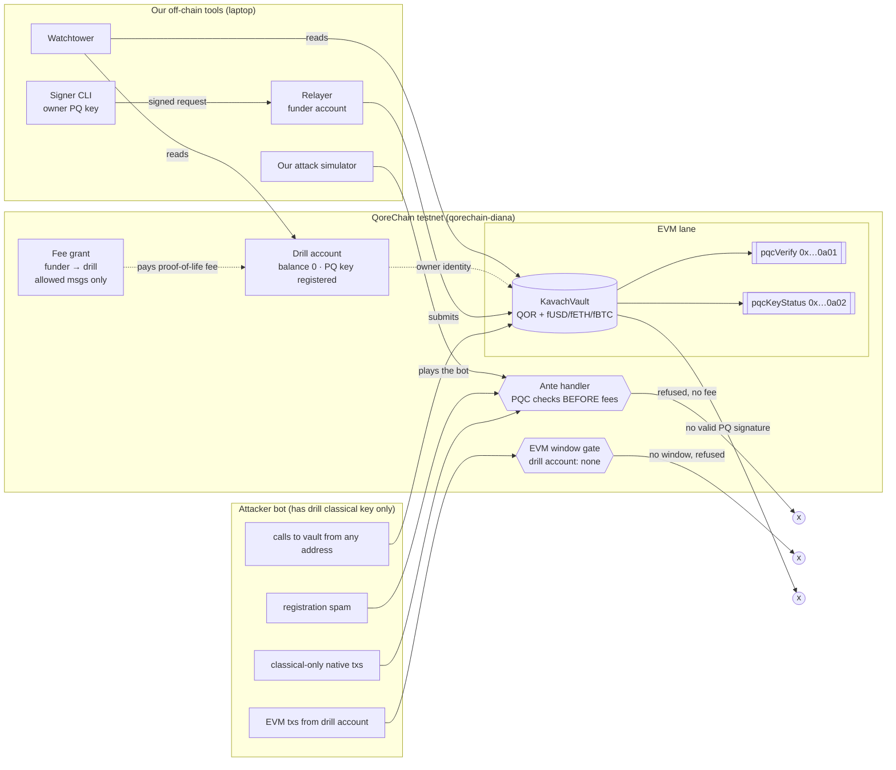
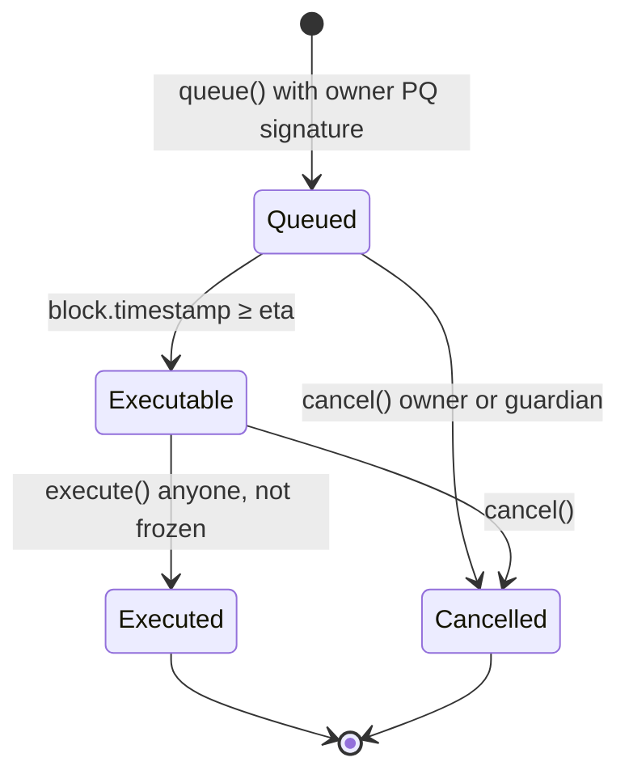
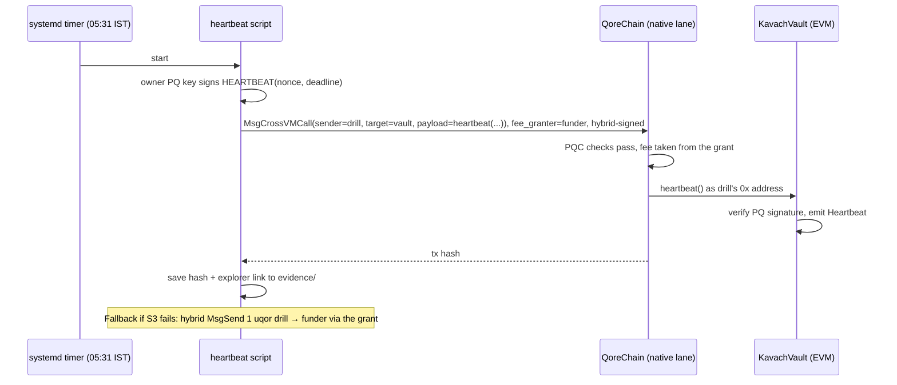

# Kavach Vault: system architecture

> Version 2, 17 Nov 2026. Supersedes `99-archive/ARCHITECTURE-v1-2026-11-17.md`.
> Network: `qorechain-diana` testnet, release v3.2.8, EVM chain id 9800.
> RPC `https://rpc-testnet.qore.host` · REST `https://api-testnet.qore.host` · EVM `https://evm-testnet.qore.host`

## 0. How to use this document

Exact function signatures, byte layout, defaults and errors are in `10-VAULT-SPEC.md`; that file wins if the two disagree.


For the coding agent:
1. Read §1–§4 once, then the section for the phase you are on in `05-BUILD-PLAN.md`.
2. Before touching an SDK, read the installed version's types in `node_modules`. Do not trust memory for `@qorechain/sdk`, `@qorechain/pqc` or `@qorechain/evm`.
3. Anything marked 🧪 depends on a spike in Phase 1. Do not build on it until the spike passes.
4. Never print, log or commit a key, recovery phrase or recovery code. Secrets live in `.secrets/` (mode 600, git-ignored).

## 1. Design principles

| # | Principle | Why |
|---|---|---|
| P1 | **The drill account has nothing to lose.** Zero QOR, zero tokens, no window, no approvals, no grants it gave, no delegations, no linked keys. | Ranking criterion 3 is value kept. An empty account cannot lose value. |
| P2 | **No window, ever, on the drill account.** | The window is the only lane where a stolen classical key acts. |
| P3 | **The caller grants nothing.** No `msg.sender` checks for authority, no `ecrecover`, no `tx.origin`. | A stolen key can call from any address. Only the post-quantum signature counts. |
| P4 | **Every outflow and every rule change needs an ML-DSA-87 signature** over a domain-separated, replay-proof message. | The attacker does not have the post-quantum key. |
| P5 | **Fail closed.** If the precompile is missing, returns empty data, or the key record changes, the vault refuses. | A broken dependency must never become an open door. |
| P6 | **Small, fixed surface.** No upgrade proxy, no `delegatecall`, no `selfdestruct`, no arbitrary call, no owner. | Every extra function is a place to be wrong. |
| P7 | **Defence in depth with separated keys.** Owner key, guardian key and funder account are independent secrets. | No single leak or bug loses everything. |
| P7b | **Lose the least even in the worst case.** Most value sits in a cold vault that cannot move before 20 Nov; a small hot vault does the live work. | A bug we did not foresee can cost at most the hot vault's capped balance. |
| P8 | **Prove, don't claim.** Every security claim has a test, and the live attack log is public. | Ties are broken by the jury on the threat model. |

## 2. Master diagram



## 3. Accounts and keys

| Account / key | Kind | Holds | Used for | Where the secret lives |
|---|---|---|---|---|
| **Drill account** (`qor1…drill`, `0x…drill`) | Unified eth-native account, eth_secp256k1 + ML-DSA-87 | Nothing, ever: its registration fee is paid through a temporary grant (D-14) | Owner identity of the vault (its registered PQ key is the owner key); sends the proof-of-life transaction | Recovery phrase in `.secrets/drill.mnemonic`. Classical private key handed to the organisers. |
| **Owner PQ key** | ML-DSA-87, derived from the drill account's recovery phrase and address | – | Signs vault requests | Derived on demand from `.secrets/drill.mnemonic`, never stored separately |
| **Guardian PQ key** | ML-DSA-87 from a separate `QRC1-` recovery code | – | Freeze, cancel queued actions, co-sign unfreeze | `.secrets/guardian.qrc` |
| **Funder / relayer account** | Native account, hybrid | Gas QOR | Deploys, funds the vault, grants the fee allowance, relays signed requests | `.secrets/funder.mnemonic` |
| **Your dashboard wallet** (`qor1z226…fkhvuh`) | Your registered account | 1,100 test QOR | Source of test QOR only. Never part of the drill. | Your QoreX |

Why the owner key is the drill account's own registered key: the rules ask for "a testnet account its project uses". Binding the vault to the drill account's registered key makes the account central to the project, and it means the vault's trust anchor is visible on chain (`pqcKeyStatus(drill)`), which a judge can check.

## 4. The two lanes for our own actions

| Our action | Lane | Window needed? | Signed by |
|---|---|---|---|
| Register drill PQ key | Native | No | Drill classical (the one exception) + proof of possession |
| Grant fee allowance to drill | Native | No | Funder (hybrid) |
| Deploy vault | EVM | Funder's own unscoped window, closed right after | Funder |
| Fund vault (QOR, tokens) | EVM or native | Funder's window, closed after | Funder |
| Withdraw, change limits, rotate | EVM call to vault | Funder's window scoped to the vault, short-lived | Request signed by owner PQ key; submitted by funder |
| **Proof of life** | Native (`MsgCrossVMCall` → `heartbeat`, fallback `MsgSend` of 1 uqor to the funder) 🧪 S3 | **No** | Drill account, hybrid, fee paid through the grant |

The drill account itself never touches the EVM lane.

## 5. KavachVault contract

### 5.1 Storage

```solidity
bytes32 public ownerKeyHash;                 // keccak256 of the owner's 2,592-byte ML-DSA-87 public key; changes only by rotation through the timelock
address public immutable OWNER_ACCOUNT;      // drill account's 0x address, for the live pqcKeyStatus check
bytes32 public guardianKeyHash;              // changed only through the timelock
uint64  public ownerKeyVersion;              // bumps on rotation; old signatures die
uint64  public guardianKeyVersion;
mapping(uint8 role => uint64) public nonces; // per-role, strictly increasing
bool    public frozen;
Limits  public limits;                       // per-tx cap, daily cap, timelock delay (per asset)
mapping(address => bool) public allowedRecipient;
mapping(address => bool) public listedToken; // QOR (address(0)), fUSD, fETH, fBTC
Window  public spent;                        // rolling 24 h spend per asset
mapping(bytes32 id => Queued) public queue;  // large withdrawals and rule changes
```

### 5.2 Message format (what the PQ key signs)

Fixed length, fixed field order, all big-endian:

```
0xFF                          1 byte   domain byte: no SDK-signed format starts with 0xFF
"KAVACH-VAULT-v1" (padded)   31 bytes domain name
chainId                      32 bytes 9800
vault address                32 bytes
action id                    32 bytes WITHDRAW | QUEUE | EXECUTE | CANCEL | FREEZE | UNFREEZE | SET_LIMITS | SET_RECIPIENT | ROTATE_KEY | HEARTBEAT
role                         32 bytes OWNER | GUARDIAN
key version                  32 bytes must equal the current version for the role
nonce                        32 bytes must equal nonces[role]
deadline                     32 bytes unix seconds; refuse after
action fields                fixed per action (asset, to, amount, new values…)
```

Why each field: domain byte and name stop cross-protocol replay; chain id and vault address stop cross-chain and cross-vault replay; key version kills signatures from a rotated key; nonce stops replay within the vault; deadline stops late use.

### 5.3 Verification (every privileged function)

```solidity
function _auth(uint8 role, bytes calldata pubkey, bytes calldata sig, bytes memory message) internal {
    // 1. Key matches what we pinned for this role
    require(keccak256(pubkey) == (role == OWNER ? ownerKeyHash : guardianKeyHash), "key");
    // 2. Owner only: chain still holds this exact key, registered with proof of possession
    if (role == OWNER) {
        (bool registered, uint8 algo, bytes memory onchainPk, bool pop) = PQC_STATUS.pqcKeyStatus(OWNER_ACCOUNT);
        require(registered && algo == 1 && pop && keccak256(onchainPk) == ownerKeyHash, "keystatus");
    }
    // 3. Signature valid (typed call: reverts on empty return data → fail closed)
    require(PQC.pqcVerify(pubkey, sig, message), "sig");
    // 4. Consume the nonce
    nonces[role]++;
}
```

Gas: `pqcVerify` costs 25,000 + 8 per byte [DOC], about 85,000 gas for a 2,592-byte key and 4,627-byte signature plus a ~400-byte message.

### 5.4 Functions

| Function | Who signs | Rule |
|---|---|---|
| `deposit()` / `depositToken(token, amount)` | Nobody | Anyone. Only listed tokens. |
| `withdraw(asset, to, amount, deadline, pk, sig)` | Owner | `to` allowlisted, `amount ≤ perTx`, rolling 24 h total ≤ daily cap, not frozen |
| `queue(action, fields, deadline, pk, sig)` | Owner | Larger withdrawals and every rule change; executable after `timelockDelay` |
| `execute(id)` | Anyone | Only after the delay, only if not cancelled, not frozen |
| `cancel(id, …)` | Owner or guardian | Immediate |
| `freeze(…)` | Owner or guardian | Immediate |
| `unfreeze(…)` | Owner **and** guardian | Two signatures in one call |
| `heartbeat(deadline, pk, sig)` | Owner | Emits `Heartbeat(nonce, block)`. No value moves. Used for proof of life and liveness evidence. |
| `rotateOwnerKey` | Owner, via queue | Bumps `ownerKeyVersion`; the new key must also be the drill account's registered key (live check). |
| Fallback / receive | – | `receive()` accepts QOR deposits only. `fallback()` reverts. |

No other external function changes state.

### 5.5 State machine (queued action)



### 5.6 Invariants (tested by fuzzers and proved in `SECURITY-PROOFS.md`)

- **I1** Without a valid owner signature, no sequence of calls lowers any asset balance of the vault.
- **I2** No attacker-controlled address ever receives value from the vault.
- **I3** A signature is accepted at most once (nonce) and never after its deadline or after a key rotation.
- **I4** Total outflow per asset in any 24 h window ≤ daily cap, except queued actions after their delay.
- **I5** The guardian can never move funds.
- **I6** With the precompile absent or returning empty data, every privileged call reverts.
- **I7** With honest keys and no freeze, the owner can always withdraw everything (liveness), within limits plus the timelock.

## 6. Off-chain tools (TypeScript, Node 22, `@qorechain/sdk` 0.14+, `@qorechain/pqc`, viem)

| Tool | Command | What it does |
|---|---|---|
| Key generator | `pnpm keys:new` | Creates drill, funder mnemonics and guardian recovery code into `.secrets/` (600). Prints addresses only. |
| Registrar | `pnpm keys:register` | `ensurePqcRegistered` for drill and funder with proof of possession. Verifies `possession_proven: true`. |
| Grant | `pnpm grant` | Funder grants the drill account an `AllowedMsgAllowance` (spend limit 1 QOR, expiry 20 Nov, allowed: `MsgCrossVMCall`, `MsgSend`). 🧪 S2 |
| Deployer | `pnpm deploy` | Funder opens an unscoped window, deploys, verifies, funds the vault, closes the window, confirms `found: false`. |
| Signer | `pnpm sign <action>` | Builds the §5.2 message, signs with the owner or guardian key, prints the request. |
| Relayer | `pnpm relay <request>` | Opens a window scoped to the vault for the funder (`allowed_targets=[vault]`, 1 tx, small value), submits, closes. |
| Heartbeat | `pnpm heartbeat` | Drill account sends the hybrid native heartbeat through the grant; prints hash and explorer link. |
| Watchtower | `pnpm watch` | Polls every 15 s: drill window (`found` must stay false), drill key record, drill balance, vault balances, vault events. Logs to `evidence/watch.jsonl`. On an anomaly: alert and submit a pre-signed guardian freeze. |
| Attack simulator | `pnpm attack` | Plays the bot with only the drill classical key (full list in `04-THREAT-MODEL.md`). Writes `evidence/attack-log.json` with tx hashes and outcomes. Exits non-zero if anything succeeds. |
| Evidence pack | `pnpm evidence` | Snapshots balances, key record, window state and explorer links into `evidence/` before and after the drill. |

## 7. Proof of life (sequence)



## 8. Repository layout

```
kavach-vault/
  contracts/        KavachVault.sol, interfaces/IQorePQC.sol, test mocks
  test/             Foundry unit, adversarial, invariant (+ Medusa config, Halmos specs)
  scripts/          keys, register, grant, deploy, sign, relay, heartbeat, watch, attack, evidence
  evidence/         live JSON logs and snapshots (committed after the drill)
  docs/             this folder
  .secrets/         git-ignored, mode 600
  AI_USAGE.md       generated from docs/08-DECISIONS.md and the build log
  SECURITY-PROOFS.md
  README.md
```

## 9. Configuration (names only)

`QORE_RPC`, `QORE_REST`, `QORE_EVM_RPC`, `QORE_CHAIN_ID=qorechain-diana`, `QORE_EVM_CHAIN_ID=9800`, `VAULT_ADDRESS`, `FUNDER_ADDRESS`, `DRILL_ADDRESS`, `SECRETS_DIR=.secrets`.

## 10. Value tiers (added 17 Nov, 03:30 IST)

| Tier | Contract | Share of value | Can move during the drill? | Worst case if it had a bug |
|---|---|---|---|---|
| 0 | Drill account | 0% | – | Nothing to lose |
| 1 | **Cold vault** (`KavachColdVault`) | ~85% | **No, by construction** (release time 20 Nov 00:00 UTC) | Tiny code; outflow impossible before release |
| 2 | **Hot vault** (`KavachVault`) | ~15% | Only with an owner ML-DSA-87 signature, within limits | Capped by daily limit, then frozen by the watchtower |

Both contracts are registered among the five drill contracts. Both are caller-agnostic and owner-bound to the drill account's registered post-quantum key.
