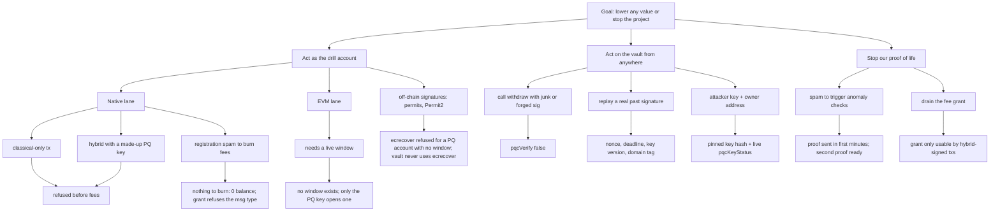

# Threat model

## 1. Assets

| Asset | Where | Target value at drill start |
|---|---|---|
| QOR | Vault (EVM balance) | As much as we can collect (your 1,100 test QOR + daily faucet claims) |
| fUSD, fETH, fBTC | Vault (ERC-20 balances) | Every faucet claim we can make before the drill |
| Vault rules (limits, allowlist, keys) | Vault storage | Unchanged |
| Liveness (owner can act, proof of life lands) | Chain + our tools | Proof of life in the first minutes |
| Drill account | Native | **0** of everything, by design |

## 2. Attacker

| Class | Holds | Can do |
|---|---|---|
| **A-Drill** (the official bot) | Drill account's classical secp256k1 key, all public chain data, any number of its own funded accounts | Sign anything with the classical key; call any contract from any account; read every past signature on chain |
| **A-Public** (after 19 Nov) | Same key, published | Same, forever |
| A-Front-runner | Mempool view | Copy our relayed requests |

Out of scope: theft of our laptop or `.secrets/`; a bug in QoreChain's own consensus or post-quantum module (we limit the damage, see §6).

## 3. Attack tree

## 4. Attacks and defences

Status: **Doc** = stated in QoreChain docs · **Code** = read in public source · **Test** = our live attack simulator must show it blocked before we register · **Design** = removed by construction.

### 4.1 The five named attack families

| # | Attack | Defence | Status | Test id |
|---|---|---|---|---|
| A1 | Native QOR transfer, classical-only | Refused for an account with a registered key; refused before fee deduction | Doc, Code (order), Test | T-A1 |
| A2 | Open an EVM window, classical-only | Window messages must be hybrid-signed | Doc, Test | T-A2 |
| A3 | EVM transfer of QOR from the drill account | No live window → code 26 | Doc, Test | T-A3 |
| A4 | Token approval / permit / Permit2 | No window for the EVM call; `ecrecover` refused for a PQ account without a window; account holds no tokens | Doc, Design, Test | T-A4 |
| A5 | Drain calls on our contracts | Vault ignores the caller; every outflow needs an owner PQ signature | Test (unit + live) | T-A5 |

### 4.2 Further attacks we add (the bot "tries everything")

| # | Attack | Defence | Status | Test id |
|---|---|---|---|---|
| B1 | Replace the PQ key with a classical-only registration | Account already holds a key → code 234 | Doc, Test | T-B1 |
| B2 | Registration spam to burn the account's QOR in fees | **Zero balance**; grant's allowed-message list excludes key messages, so fee deduction fails in the ante handler | Code (order), Test (S1, S2) | T-B2 |
| B3 | Hybrid tx with an attacker-made PQ key | Signature does not match the registered key | Doc, Test | T-B3 |
| B4 | Rotate or migrate the PQ key | Dual-signed / hybrid-signed | Doc, Test | T-B4 |
| B5 | EIP-7702 delegation | Needs the account's own hybrid-signed consent | Doc, Test | T-B5 |
| B6 | Link an authenticator or session key | Needs the owner's hybrid signature | Doc, Test | T-B6 |
| B7 | authz grant, fee grant from the drill account | Native, needs hybrid | Doc, Test | T-B7 |
| B8 | Cross-VM call, IBC transfer, staking, governance vote | Native, needs hybrid | Doc, Test | T-B8 |
| B9 | Use our fee grant for its own transactions | Grant pays only after the PQ checks pass; the bot cannot produce the PQ signature | Code (order), Test | T-B9 |
| B10 | Replay a past owner signature into the vault | Nonce, deadline, key version, chain id, vault address | Test | T-B10 |
| B11 | Replay an SDK-signed message (tx, proof of possession, rotation) as a vault message | `0xFF` domain byte; fixed length | Proof + Test | T-B11 |
| B12 | Junk, truncated, oversized, all-zero signatures; wrong-length keys | `pqcVerify` false; typed call reverts on empty data | Test | T-B12 |
| B13 | Attacker's own valid ML-DSA key and signature | Pinned key hash ≠ attacker key | Test | T-B13 |
| B14 | Front-run a relayed withdrawal | Recipient and amount are signed; front-runner only pays our gas | Design, Test | T-B14 |
| B15 | Reentrancy through `receive` of a recipient | Reentrancy guard; checks-effects-interactions; recipients allowlisted | Test | T-B15 |
| B16 | Force-send QOR or tokens to confuse accounting | Accounting uses tracked limits, not balance deltas | Test | T-B16 |
| B17 | Deposit a fake token | Only listed tokens accepted | Test | T-B17 |
| B18 | Grief: fill the queue, spam heartbeats | Every queue entry and heartbeat needs an owner signature | Test | T-B18 |
| B19 | Precompile disabled or returning empty data | Fail closed (I6) | Test (mock) | T-B19 |
| B20 | Spam to trigger the AI anomaly check on our account | Proof of life sent in the first minutes; fallback proof ready | Design | – |
| B22 | Hybrid tx carrying the attacker's own PQ public key in the extension (`includePqcPublicKey`, the SDK's "auto-register on first use" path) to take over the account | Account already holds a key; any further key change needs the existing key (code 234) | Doc, Test | T-B22 |
| B21 | Attack after 19 Nov with the published key | Same defences, no time limit | Design | invariants |

## 5. Ranking impact

| Ranking criterion | Our expected result | Why |
|---|---|---|
| Proof of life | ✅ in the first minutes | Scheduled, pre-tested, fallback ready |
| Fewest successful attacks | 0 | Nothing in §4 succeeds; verified live before registering |
| Most value kept | 100% of the contracts' value; account had 0 to lose | P1, P2 |
| Threat model | Written proofs + 2 fuzzers + symbolic checks + live logs | `09-TIE-BREAK-DOSSIER.md` |

## 6. Residual risks

| Risk | Likelihood | Impact | Response |
|---|---|---|---|
| Bug in QoreChain's closed-source PQC module lets a classical-only tx through | Low | Account has nothing; vault still needs a PQ signature | Two independent layers |
| Our vault has a bug | Low after tests | Loss of vault value | 2 fuzzers, symbolic checks, AI red team, review |
| Rules change before the cut-off | Low | Design mismatch | Re-read rules at 23:00 IST 17 Nov |
| Our laptop or network fails at 05:30 | Medium | No proof of life | Timer + you awake + fallback RPC |
| Organisers count something we did not foresee as "successful" | Unknown | Ranking | Ask Q1–Q3 privately |

## 7. Exhaustive coverage (added 17 Nov, 03:30 IST)

The tables above are the attacks we reason about. The live simulator goes further:
- **C1 Native sweep:** one classical-only transaction per message type in the chain's registry (74 QoreChain types + every standard module type, see `02-RESEARCH.md` §9.1). Expected: every one refused before fees; drill balance stays 0.
- **C2 Fee-granted sweep:** the same sweep with `fee_granter = funder`. Expected: refused; grant unchanged.
- **C3 EVM sweep:** raw EVM transactions from the drill key: plain transfer, contract creation, a call to every function selector of both vaults, each fest token's `approve`/`transfer`, permit and Permit2 shapes. Expected: refused (no window).
- **C4 Contract sweep from a third funded account:** every external function of both vaults with fuzzed arguments, junk and replayed signatures. Expected: revert; balances unchanged.
- **C5 Post-drill:** the same sweeps repeated after the key is published.

Reported as counts ("N of N blocked") with tx hashes, so the claim is checkable rather than a number we chose.

## 8. Live results (17 Nov, testnet qorechain-diana; `evidence/attack-log.json`)

| Attack ids | Live result | Evidence |
|---|---|---|
| A1, B1, B3, B4, B5, B6, B7, B8, B9, B22 | Refused at the PQ gate (code 20, or 234 for key registration); drill balance 0, sequence and fee grant unchanged. Fee-granted variants refused too (B9) | `attack-native.json` |
| A2 | Window open refused (hand-built H3, H4) | same |
| A3, A4 | Refused: zero balance for the drill, missing window for a funded stand-in. Token approve/transfer/Permit2 shapes included | `attack-evm.json` |
| A5, B10–B14, B16–B19 | 78 call attacks reverted for the intended reasons; live reverted txs; forced QOR does not affect accounting; liveness after attacks | `attack-vault.json` |
| B15 | Foundry reentrancy tests (guard-independent) plus mutation testing | `evidence/mutation-report.md` |
| B2 | Nothing to burn: drill balance 0 throughout, grant unchanged | `attack-native.json` |
| Cold release | Refused while locked (live); canary proves the unlock path and refuses attacker keys and replays | `phase4b-cold-canary.json` |
| New finding (N1) | The chain refuses EVM transactions from any account without a registered PQ key and open window; the bot's own funded accounts are in the same position | live error text in `attack-evm.json` |
Known limit of 5.1: about 50 registry types were refused by stateless validation of our placeholder bodies before reaching the account check, and 3 could not be encoded by the SDK. The 14 hand-built attacks and 84 distinct types that did reach the gate show the check applies to the account, not to the message type.
