# AI workflow, and how it becomes AI_USAGE.md

The Best AI-Native Build award ($500, main hackathon) rewards "the strongest documented use of AI during development", judged from `AI_USAGE.md`: "the workflow, the generated work and the human contribution". Judges have read many vague AI write-ups. Ours wins by being **specific, verifiable and honest about AI mistakes**.

## 1. Principles

1. **AI drafts, evidence decides.** Nothing an AI writes is trusted until a test, a live transaction or a source document confirms it.
2. **Different eyes for writing and reviewing.** The model that writes the contract is not the one that attacks it; the red team gets only the contract and the threat model, not our reasoning.
3. **Log as we go.** Decisions, prompts and corrections go into the logs during the build. `AI_USAGE.md` is assembled from them, not written from memory.
4. **Humans own the irreversible steps.** Funding, registration, pasting the drill key, GitHub pushes and anything public are done or approved by a person.

## 2. The pipeline

```mermaid
flowchart LR
  R[Research<br/>Exa search · docs repo · node source · 61 project pages] --> T[Threat model<br/>attack tree, invariants]
  T --> S[Spikes<br/>live testnet experiments]
  S --> B[Build<br/>contract + scripts]
  B --> V1[Verify 1<br/>unit + adversarial tests]
  V1 --> V2[Verify 2<br/>Foundry invariants + Medusa]
  V2 --> V3[Verify 3<br/>Halmos symbolic + Slither + Aderyn]
  V3 --> RT[AI red team<br/>separate agent, blind to our reasoning]
  RT --> L[Live attack simulator<br/>on testnet]
  L --> H[Human gates<br/>review, fund, register]
```

| Stage | AI role | Human role | Evidence produced |
|---|---|---|---|
| Research | Exa queries, reading docs and source, competitor scan | Chose the target and constraints | `02-RESEARCH.md` with sources |
| Threat model | Drafted the attack tree and invariants | Challenged it ("think beyond the five named attacks") | `04-THREAT-MODEL.md` |
| Spikes | Wrote and ran experiments | Sent test QOR, faucet claims | Tx hashes in `02-RESEARCH.md` §7 |
| Contract | Wrote code and tests | Reviewed the diff, approved design choices | Git history |
| Verification | Ran fuzzers, symbolic tools, static analysis | Read the reports | `SECURITY-PROOFS.md`, tool output |
| Red team | Separate agent tried to break the vault | Decided fixes | Findings table |
| Drill ops | Scripts, watchtower | Registration, proof submission | `evidence/` |

## 3. Tools

| Tool | Use | Why |
|---|---|---|
| Claude Code (Opus for architecture and review, Sonnet for implementation) | Planning, code, tests, docs | Strongest available reasoning for design; fast implementation |
| Exa (custom skill `~/.claude-usage/skills/exa`) | Web research with page text | Found competitor pages, ML-DSA guidance, fuzzing comparisons |
| Playwright (headless Chrome) | Reading every project page and the rules | The projects list needed scrolling; repeatable |
| Foundry (forge) | Unit, adversarial and invariant tests | Standard for Solidity |
| Medusa | Second fuzzing engine on the same properties | Different search strategy finds different bugs ([guardian.security, Nov 2026](https://guardian.security/blog/echidna-vs-medusa-vs-foundry/)) |
| Halmos | Symbolic checks on auth, limits, queue | Covers all paths within bounds, not samples |
| Slither, Aderyn | Static analysis | Two independent rule sets |
| Trail of Bits skills (installed) | Secure-workflow and property-based-testing guidance | Audit-firm methodology |
| `@qorechain/sdk`, `@qorechain/pqc` | Real ML-DSA-87 keys and signatures in every test | No mocked cryptography in the assertions that matter |

## 4. Logs we keep during the build

| File | Content |
|---|---|
| `docs/08-DECISIONS.md` | Every decision: options, evidence, who approved |
| `docs/build-log.md` | One entry per sub-phase: what the AI did, what failed, how it was fixed, commands to reproduce |
| `docs/ai-corrections.md` | Every time AI output was wrong (a wrong assumption, a bad test, a hallucinated API), and the check that caught it |
| Git commit trailers | `Co-Authored-By:` on AI-written commits; human-only commits have none |

Already logged corrections from the research phase (examples of what goes into `ai-corrections.md`):
- An early message said the drill cut-off was "about 17 hours" away; recomputing from UTC gave about 28 hours. Caught by converting 17 Nov 23:59 UTC to IST explicitly.
- An early design assumed a small drill-account balance was harmless; reading `app/ante.go` and the docs' fee note led to the zero-balance + fee-grant design.
- The first scrape of the hack4hack page was taken as the full project list; the API showed hidden projects. Lesson carried over: always look for the full data source.
- The cold-vault release time was first written as `1795651200`, which is 26 Nov, not 20 Nov. Caught by converting the number back to a date (`date -u -d @…`) before relying on it; corrected to `1795132800`. Rule added: every timestamp in the spec is checked by round-trip conversion.

## 5. AI_USAGE.md outline (filled at the end)

1. Summary: what AI did and did not do, in five lines.
2. Workflow diagram (above) with the real numbers (tests run, fuzz runs, findings).
3. Per-file provenance table: AI-written / AI-written then human-edited / human-written.
4. Decision log extract: the five decisions that mattered most and the evidence behind them.
5. Where AI was wrong: the corrections log.
6. Verification results: test counts, invariant runs, symbolic proofs, red-team findings and fixes, live attack log.
7. Human contribution: goals, constraints, approvals, every on-chain action that needed a person.
8. How to reproduce: exact commands.
